# Existing custom graphics — review gallery

These are the actual retained project assets and native screenshots, not new
concept art or replacements. No artwork changed during RC1 QA. In Safari/GitHub,
tap an image to open it at its native size.

| Character | Editable overworld sheet | Existing battle art |
| --- | --- | --- |
| Male protagonist | 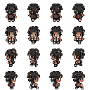 | 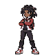 |
| Sabrina | 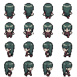 | 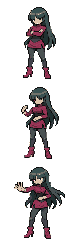 |
| Sister / female player | 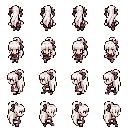 | 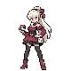 |

Male: brown skin, dreadlocks/gold accents, red/white jacket and dark clothing.
Sabrina: long black-green hair and burgundy outfit. Sister: silver-white hair,
red eyes, burgundy ribbon and burgundy/black feminine clothing. Pixel-scale
detail is limited by native sprite dimensions; the recovered designs are preserved.

## Native test captures

| Male Trainer Card | Female Trainer Card |
| --- | --- |
| 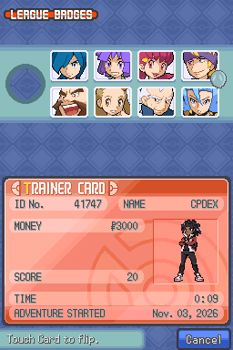 | 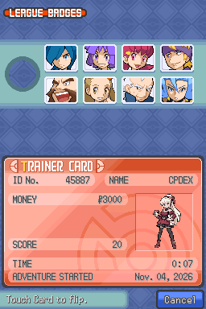 |

| Player, Pokémon and Sabrina | Separate AI partner battle |
| --- | --- |
| 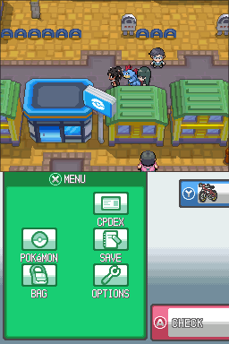 | 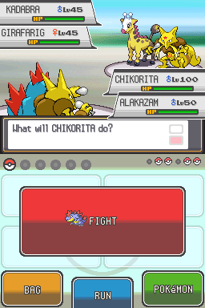 |

| Official Sabrina challenge | Female route neutral breeder |
| --- | --- |
| 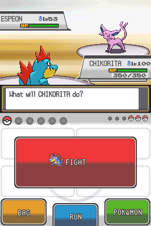 | 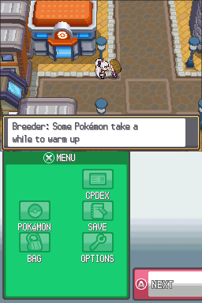 |

Special-action art is retained in [characters/actions](../../characters/actions/).
Actual-ROM conversion/pixel checks pass. Cycling, Surf and rod casting received
native captures; Rocket/Pokéathlon and every other animation have not all been
visually played. Original 3D Bag models still appear in the Bag, and Sabrina's
separate partner presentation uses existing front/profile poses. These are
known limits, not claims that every requested appearance is complete.

See [coverage and tested versions](COVERAGE.md) and [full asset audit](evidence/final-assets.json).
