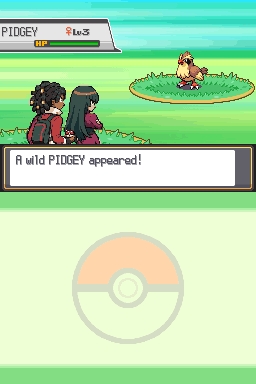
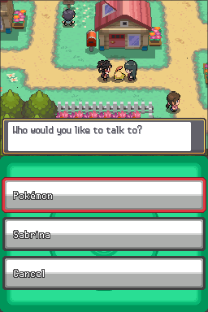
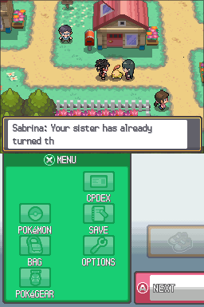
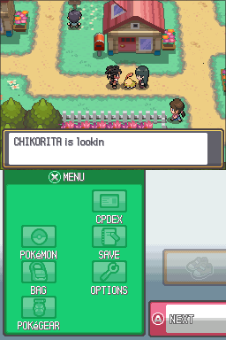
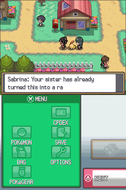
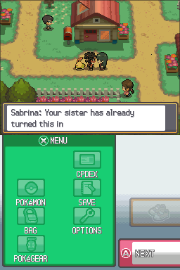
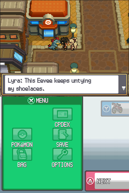
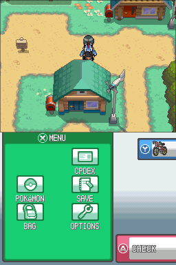
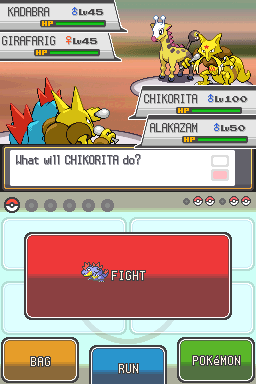
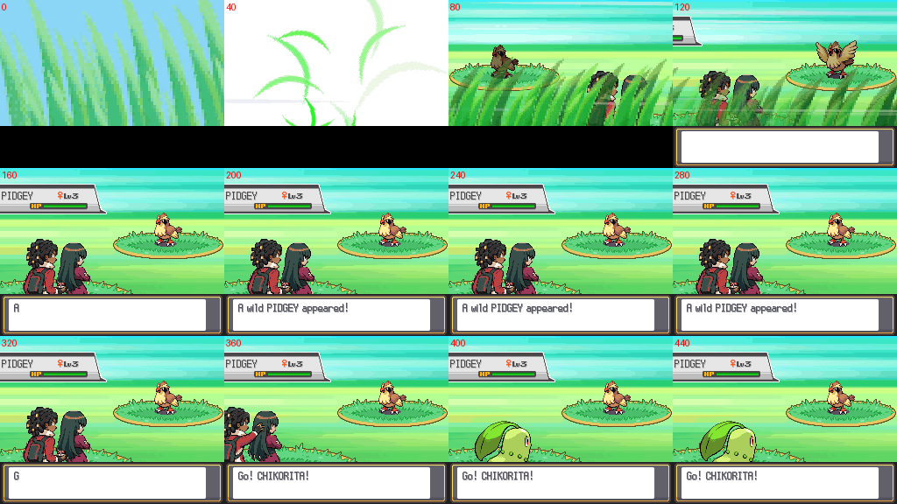

# HeartGold Manic repair build RC2 — 4 November 2026

This is a focused repair test build, **not an exhaustively validated release**.
The original RC1 ROM, patches, branches and commits remain recoverable.

## Repository and checkpoint

Actual feature repository: `mbanks26/pokeheartgold1`. Inspection of both requested
repositories found the completed features here; `mbanks26/pokeheartgold` has an
older master. The latest integrated foundation was `0cb6b13bdb0c084a8494e4bbf30a92211314826f`
on `development/release-candidate-20261104`, descended from graphics milestones
`afd4151f`, `bda9631d`, `2c669251`, companion `4ea2dc8a`, validation `bcf2f8fd`,
and story/partner integration `110f4acf`.

Repairs are isolated on **`development/manic-repairs-20261104`**. No master merge,
reset, branch deletion or force push. This document's containing repair commit
is the exact game-source checkpoint; `DELIVERY.md` records final publication SHAs.
Commercial ROM bytes and emulator memory/save states are excluded from Git.

## Fixes and root causes

* **Red skin:** the old shared MEDIANCUT palette spent three of fifteen opaque
  entries on the white background and retained no brown skin colors. Brown face
  pixels mapped to jacket reds. `repair_paired_battle.py` removes exterior white
  before conversion and reserves distinct RGB555 brown shades at indices 6–8.
  Red clothing, green-black hair, burgundy clothing, skin highlights and gold
  remain distinct. Transparency is index 0. All eight frames retain brown pixels.
  A real native wild-battle capture confirms brown skin; other battle contexts
  share these exact converted resources, but were not all individually rendered.
* **Choppy back animation:** old conversion independently cropped, scaled and
  centered each pose. One global crop, scale and baseline now govern all eight
  80×80 frames. Nearest-neighbor conversion, original OAM/cell/animation tables,
  frame order, timing and archive size are preserved. Only back graphics 0 and 15
  (six pixel/palette members) changed. **A brief throwing-arm/hair overlap remains**;
  fixed geometry improves consistency but does not make the original pose art
  fully polished. See the captured animation sheet below.
* **Disappearing conversation:** the generic task suppression deleted the human
  object during her own dialogue task. A runtime conversation latch now freezes
  that same object, finishes an active tile and faces the player. It never
  recreates her during her own conversation. Cycling, surfing, Gym/canonical NPCs
  and unrelated cutscene suppression retain their normal guards.
* **A interaction:** facing the native following Pokémon opens the native menu
  **Pokémon / Sabrina / Cancel**, only while Sabrina is present. Pokémon invokes
  the original follower interaction; Sabrina calls the same context selector as
  Select. The menu temporarily hides the touchscreen UI as required by native
  menu rendering. Adjacent direct Sabrina interaction has no chooser and runs
  after ordinary NPC/object interaction priorities. Select remains supported.
* **Rushing/evading:** walking uses native walking steps rather than unconditional
  running steps. Native running and a trail backlog allow catch-up. Sabrina waits
  for a player/Pokémon-occupied trail tile instead of despawning and pauses when
  approached facing her. Safe-tile, bounded recovery and separate object identity
  remain intact. This is not a claim of perfect movement on every map.
* **Lyra:** formal dialogue prefixes in five custom town banks and all five
  custom trainer records 738–742 now say Lyra. Natural references to 'your sister'
  remain. No player naming, white-haired artwork, roster, Eevee or sibling event
  logic changed. No twin relationship was added.
* **Battle selection:** ordinary one-trainer Double Battles use the combined art
  too. Multi/Link/Frontier/tutorial and opposing Sabrina/Gym suppression preserve
  solo/independent partner presentation. No AI, damage or party-control code changed.

## Preservation and dialogue

The approved full-color paired master is now stored at
`characters/male/paired-master.png` (SHA-256 in `paired-conversion.json`) so future
workspace deletion cannot lose it. All existing male, Sabrina and white-haired
Lyra overworld/action/intro/card/portrait resources remain. Solo and partner battle
resources are unchanged. Actual-ROM asset validation checks 384 filesystem entries,
308 NARCs / 56,728 members, custom texture pixels/palettes and eight intro slots.
Stock Bag-screen 3D models remain original; custom 2D art does not replace those.

Existing Sabrina context dialogue remains intact, including progression gates
for the requested towns, League and Kanto and the no-spoiler Ecruteak/Lake guards.
All 31 context/input assertions and common-text preservation checks pass. Context
is evaluated on talking, not forced on every map entry. No unnecessary dialogue
rewrite was made. Existing romance/childhood/family history, Lyra's independent
journey, Eevee, genuine shiny starters, three partner events and female-route
safety guards remain in source.

Static preservation verifies 965 original script dispatch tables, 491 map-event
collections and 32 native battle/AI files. Bill's Eevee, Lance and original Sabrina
Gym/Dojo scripts are byte-identical to the follower milestone. This proves source
preservation, not that the entire adventure has been played.

## Independent tests of this repair

Eight host test entrypoints pass (companion is an alias of stabilization, not a
second independent controller suite):

| Test | Result / scope |
|---|---|
| Stabilization/controller | 92 assertions, actual C through host engine stubs |
| Context/input | 31 assertions plus pagination/original-text preservation |
| Shiny starter creation | 300,000 actual PID generations across all three choices |
| Story daily reset | 8,192 cases; persistent flags retained, normal daily flags clear |
| Partner data/AI | 44 legal moves, seven records, native AI/Multi route |
| Save import | CRC/footer validation; existing-save overwrite refused |
| Palette/animation | Eight frames, brown face pixels, separate red, transparency, protected resource tables |

DeSmuME 0.9.12 libretro, native inputs and software rendering were used on the
**final RC2 ROM**. Prepared prerequisites are explicit; no runtime battle results
or AI choices were written. Screenshots are native captures unless marked contact sheet.

| Native scenario | Evidence / limits |
|---|---|
| Select repeated three times | Same Sabrina object address, human and Pokémon visible throughout sampled dialogue; resumed |
| A formation chooser | Pokémon, Sabrina and Cancel paths; native Pokémon dialogue retained; both followers visible |
| Direct adjacent A | Native movement swaps past Pokémon; Sabrina holds her tile, remains visible for direct A and resumes |
| Lyra/Eevee | Native post-Eevee dialogue says Lyra; joined/disabled variants preserve Eevee, Bill gift flag and player Pokémon; save/cold Continue |
| Battery save and cold Continue | Prior RC1 battery imported; one human and one Pokémon restored; no duplicate |
| Wild Single / throwing | Native Route 29 encounter, sequential 8-frame captures through intro/throw; brown skin visible; brief overlap still visible |
| Walking / corners | Eight native corner loops, normal stops, one of each follower |
| Cycling / Surf | Human safely hidden, native Pokémon retained; normal formation restored after dismount/landing |
| Saffron Gym | Native teleporter puzzle, trainer 258, original level 53/53/55 team; victory gives Marsh Badge + one TM48; defeat gives neither and whiteout recovers both followers |
| Partner practice Multi | Native victory while only player commands Crunch; Sabrina AI; joined + victory flags saved with valid CRC; cold Continue restores formation |

The native Gym tests author location, high-level party and four defeated subordinate
trainers. The loss fixture authors HP 1/PP 0 before boot. The practice fixture is
post-Marsh. Movement prerequisites include items/badges/Repel. These are isolated
scenario tests, not evidence of natural progression to those milestones.

See `evidence/` JSON and compressed logs. Earlier task artifacts are inherited
historical evidence only. They have not been promoted to newly verified results.

## Visual evidence

The partner screenshot shows the battle after trainer entry, not proof of the
trainer's entire entry animation. The Gym screenshot similarly confirms native
Single state/team; fresh frame-by-frame Gym trainer presentation is still needed.

## Remaining issues and coverage

* **Critical/Major:** none reproduced in the bounded repair scenarios. This does
  not certify the entire game free of serious bugs.
* **Minor visual:** brief male throwing-arm/Sabrina-hair overlap in the combined
  pose remains. A requested cleaner staging image was rejected by the graphics
  service during output moderation with the unspecified category `other`; it
  returned no image. No retry or alternative recreation was used to bypass that
  rejection. Existing approved artwork and the tested conversion fixes are retained.
* **Presentation limitation:** partner trainer front/profile-derived assets are
  preserved, not newly redesigned. Stock Bag 3D models are still original.
* **Not freshly gameplay-verified:** every battle context and rematch entry,
  every action/map/ledge/stair/fishing/Fly, all three separate partner events,
  every story-context line on its actual map, every trainer name in battle,
  all female-route events, all Johto/Kanto Gyms, Champion, Red and full campaign.
  Standard Doubles selection has host coverage; that
  does not substitute for full native presentation/path testing.
* **Manic:** this new ROM has not yet been played in Manic. The user tested RC1
  and reported the original defects. Native DeSmuME captures do not verify iPhone
  color display, performance or save import.
* The supplied recording exceeds the file tool's 32 MiB limit and could not be
  inspected. The supplied screenshot and native reproductions informed repairs.

## Build, base and patch

Incremental native compilation/linking, graphics conversion, resource generation
and final NitroROM packing succeeded in the existing verified US environment.
This was not a newly configured clean-directory rebuild. SDK generated caches are
archived losslessly outside Git; source and toolchain remain available. Build
instructions remain in the main project documentation.

Required BPS base: **Pokémon HeartGold US, NTR-IPKE, revision 0, 134,217,728 bytes**.

* Clean SHA-1: `4fcded0e2713dc03929845de631d0932ea2b5a37`
* Clean SHA-256: `65f02a56842b75aa92d775d56d657a56fe3fa993550b04dc20704ab82d760105`
* RC2 SHA-1: `1a25bbefb79311a8ef12cc1a8dbbe029aac757a7`
* RC2 SHA-256: `a32a6b09a3895996f37bf05d1acbd2a7bf3712e56f46af43a017dfa6b44f72db`
* [Recovery BPS](heartgold-manic-repairs-rc2.bps), 3,956,510 bytes.
* BPS SHA-256: `c9594b9a6de0eb88ba212e9aa655d30460c5ad7e127c4055c5674fee21d8e7fb`

Own decoder and independent Rom Patcher JS decoder produce byte-identical RC2.
Wrong base and corrupted patch are rejected. See `patch-validation.json`.
A complete pre-applied NDS is also supplied privately; no patch application is
required for the normal iPhone download workflow. ROM data is absent from Git.

## iPhone installation and test checklist

1. Keep your RC1 ROM and back up the in-game battery save in Manic first.
2. Open the private download page in Safari using the same ChatGPT account.
   Wait for preparation, then tap **Save game to Files**. Import the new
   `HeartGold-RC2-Manic.nds` in Manic. Do not import a BPS as a game.
3. Import a copy of your battery save if Manic treats the filename as a new game.
   Cold boot and use **Continue**. Do not resume an old emulator save state:
   runtime code/data layout changed. No save-format or persistent-flag layout
   changes were made; prior native battery saves passed cold-load testing.
4. Talk with Select repeatedly: Sabrina and Pokémon should remain visible.
5. Face the following Pokémon and press A. Test Sabrina, Pokémon and Cancel.
   Also approach Sabrina from the side and try direct A.
6. Walk/run, stop, turn, cross doors/stairs/ledges, cycle/dismount, surf/land,
   fish, save/restart and enter a battle. Watch for duplicates or lasting disappearance.
7. Check brown skin and both characters through the entire throw; the brief
   arm/hair overlap is known. Check Lyra's name and preserved white-haired art.
8. Test partner AI without selecting Sabrina's actions and Saffron victory/loss.
   Report location, last action and a screenshot for any regression.

Optional recovery workflow: use a Safari-compatible BPS patcher such as
[Rom Patcher JS](https://www.marcrobledo.com/RomPatcher.js/), select your own exact
clean US ROM plus the BPS, then import its resulting NDS. Preserve the originals.

## Changed source files

Engine: `src/field/{field_control.c,sabrina_companion.inc,sabrina_dialogue.inc}`,
`src/pokemon.c`, `include/sabrina_companion.h`, `include/constants/std_script.h`.
Resources: `scr_seq_0003.s`, common message bank 0040, town banks 0542/0556/0581/
0612/0629, `trainers.json`, `characters/male/{paired-master.png,battle-back.png}`,
`files/a/0/0/6`. Conversion and QA: `tools/repair_paired_battle.py`,
`tools/check_manic_{interaction,wild_art}.py`, existing controller/dialogue tests,
new `tests/test_manic_palette.py`, and this evidence/report/patch directory.
